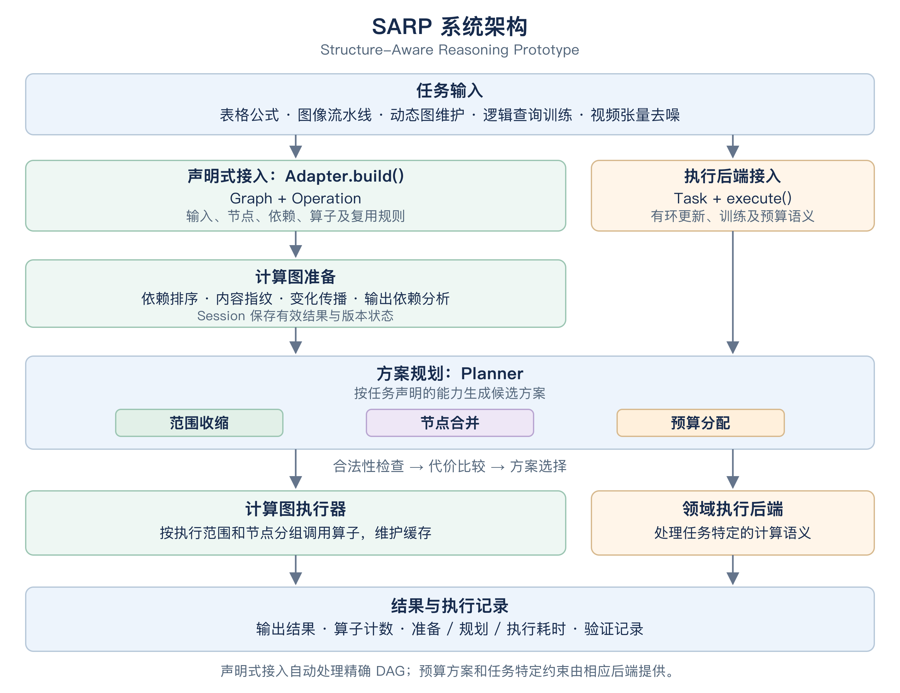
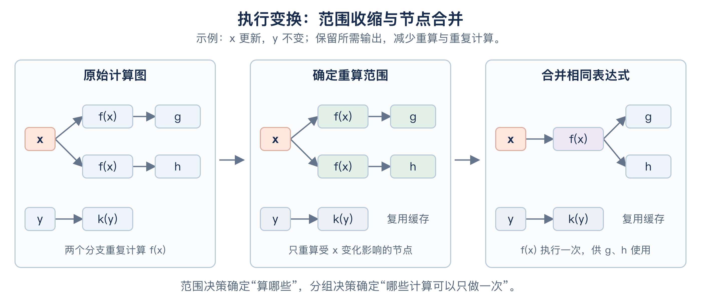

# SARP

**Structure-Aware Reasoning Prototype · 结构感知推理原型系统**

SARP 是面向结构感知高效推理的研究原型。系统以计算图描述任务，依据计算单元之间的依赖关系及其属性，在结果正确性或质量约束下选择计算范围、节点分组和计算预算，并通过实际执行验证优化收益。

项目提供计算图执行器、任务适配接口、领域执行后端和可复现的实验流程。这里的 **Reasoning** 指任务层面的推理与计算过程，覆盖动态图维护、逻辑查询训练、视频张量去噪、电子表格公式重算和图像处理流水线。

[系统架构](#系统架构) · [安装](#环境与安装) · [快速开始](#快速开始) · [接入新任务](#接入新任务) · [实验复现](#实验复现) · [实验结果](#实验结果) · [项目结构](#项目结构)

## 功能概览

| 能力 | 实现方式 |
| --- | --- |
| 范围收缩 | 根据输入、参数及版本变化追踪依赖，只重算所需输出依赖的失效节点 |
| 节点合并 | 识别算子、参数和前驱表达式一致的计算，执行一次并复用结果 |
| 预算分配 | 根据任务声明的预算范围和校准配置分配计算量，由相应后端执行 |
| 方案选择 | 检查候选方案的合法性，比较执行代价与结构组织开销，保留完整执行作为参考 |
| 状态管理 | 通过 `Session` 保存有效结果，校验输入内容、节点参数、依赖及算子版本 |
| 实验记录 | 保存输入、源文件快照、候选方案、执行计数、逐次耗时及结果误差，支持核验 |

## 系统架构



[查看 SVG 矢量图](docs/assets/architecture.svg)

任务可以通过两种方式接入：

- **声明式计算图接入**：适配器描述输入、节点、依赖、输出和算子。SARP 完成依赖分析、缓存管理、节点合并、方案选择与执行。电子表格和图像流水线采用此方式，适配器无需实现执行器。
- **执行后端接入**：适配器提供 `Task` 和具有明确计算语义的后端，用于有环更新、训练反向传播及近似预算等任务。动态图、逻辑查询训练和视频张量去噪采用此方式。

两种接入方式均使用 `core.Planner` 进行方案规划。声明式计算图目前自动处理精确的范围收缩与节点合并；预算配置及其质量约束由任务相应的后端提供。

下图展示范围收缩与节点合并如何依次作用于一个任务：



[查看 SVG 矢量图](docs/assets/transformations.svg)

## 环境与安装

| 项目 | 要求 |
| --- | --- |
| Python | 3.10 或以上 |
| NumPy | 1.24 或以上，低于 3.0 |
| 计算设备 | CPU；示例无需 GPU |
| 数据与模型 | 示例在本地构造输入，无需下载模型权重或外部数据集 |

在项目根目录执行以下命令。虚拟环境激活命令适用于 macOS 和 Linux：

```bash
python3 -m venv .venv
source .venv/bin/activate
python -m pip install -e .
```

安装后可使用 `sarp` 命令。已有合适 Python 和 NumPy 环境时，也可以直接在项目根目录运行下文的 `python -m` 命令，无需安装项目包。

## 快速开始

### 运行两个任务样例

```bash
python examples/sarp_walkthrough.py
```

该示例依次运行电子表格重算和图像处理，比较完整执行、范围收缩、节点合并、组合执行与自动选案。小规模示例的部分输入更新结果如下：

| 任务 | 完整执行的算子调用 | 自动选案的算子调用 | 选中方案 |
| --- | ---: | ---: | --- |
| 电子表格公式重算 | 81 | 12 | 范围收缩与节点合并 |
| 图像处理流水线 | 27 | 5 | 范围收缩与节点合并 |

所有模式均检查输出一致性。示例还导出可检查的计算图和方案：

- [`examples/generalization_spreadsheet.json`](examples/generalization_spreadsheet.json)
- [`examples/generalization_image_pipeline.json`](examples/generalization_image_pipeline.json)

JSON 文件包含输入形状、节点、依赖、必要处理集合、执行分组、算子计数及输出摘要。

### 运行快速实验

```bash
python -m structure_aware.generalization --quick --output results/demo_generalization
python -m structure_aware.generalization --audit results/demo_generalization
```

安装项目后，等价入口为：

```bash
sarp --quick --output results/demo_generalization_cli
sarp --audit results/demo_generalization_cli
```

实验输出目录必须尚不存在。重复运行时请更换目录名，以保留已有实验记录。

## 接入新任务

### 声明计算图与算子

下面的完整示例对同一输入声明两次平方计算。首次运行可合并重复计算，再次运行可复用会话中的有效结果。

```python
import numpy as np
from structure_aware.sarp import Graph, Node, Operation, SARP, Session


class SquareAdapter:
    operations = {
        "square": Operation(lambda x: x * x, pure=True, version="1"),
    }

    def build(self, data):
        return Graph(
            namespace="square-example-v1",
            inputs={"input": data},
            nodes=(
                Node("left", "square", ("input",), work=data.size),
                Node("right", "square", ("input",), work=data.size),
            ),
            outputs=("left", "right"),
        )


prototype = SARP()
session = Session()
data = np.arange(8192, dtype=float)

first = prototype.run(SquareAdapter(), data, session=session)
second = prototype.run(SquareAdapter(), data, session=session)

np.testing.assert_array_equal(first.outputs["left"], data * data)
print(first.metrics["kernel_calls"])   # 1：相同计算执行一次
print(second.metrics["kernel_calls"])  # 0：输入不变，复用缓存
```

适配器提供的信息如下：

| 对象 | 主要字段 | 用途 |
| --- | --- | --- |
| `Graph` | `namespace`、`inputs`、`nodes`、`outputs` | 描述任务及所需结果；命名空间隔离会话状态 |
| `Node` | `name`、`operation`、`dependencies`、`parameters`、`work` | 描述单元计算、依赖、参数及估计代价 |
| `Operation` | `kernel`、`pure`、`version` | 注册计算函数，声明复用规则和实现版本 |
| `Session` | 版本状态与有效结果 | 支持后续调用的增量重算与结果复用 |
| `Result` | `outputs`、`plan`、`candidates`、`metrics`、`timing`、`validation` | 返回输出、执行安排、计数及分阶段耗时 |

### 执行模式

通过 `prototype.run(adapter, request, session=session, mode="auto")` 指定模式：

| `mode` | 行为 |
| --- | --- |
| `auto` | 比较适用候选方案，自动选择估计代价较低的合法方案；默认模式 |
| `reference` | 按完整计算图执行，作为对照 |
| `scope` | 使用依赖分析得到的重算范围 |
| `merge` | 在完整范围内合并相同表达式 |
| `combined` | 先确定重算范围，再合并范围内的相同表达式 |

模式名称描述候选方案的构造方式；自动选案结果中的 `scope+merge` 表示组合执行。显式指定 `merge` 或 `combined` 时，任务必须允许节点合并。

调用时可传入 `validator`，其返回值应包含 `passed` 字段。对于无副作用的计算，验证失败时可回退至完整方案；有副作用的任务不会自动重放。`validation=None` 表示本次未执行外部结果验证。

### 注册执行后端

具有任务特定语义的计算可注册后端，并提交 `Task`：

```python
from structure_aware.sarp import SARP
from structure_aware.adapters.dynamic import DynamicAdapter, construct

prototype = SARP()
backend = DynamicAdapter()
prototype.register_backend(backend)

data = construct(seed=7, blocks=4, block_size=8, touched=1)
task = backend.prepare(data)
outcome, plan = prototype.execute_task(task)
print(plan.name)
```

逻辑训练和视频预算后端也通过这一接口接入。后端负责梯度、状态更新或近似计算的含义，规划器负责比较任务声明允许的执行安排。

### 接入约定

- 声明式接口接收可展开为有限有向无环图的任务；节点可按任意声明顺序提交，系统检查依赖并排序。
- `pure=True` 表示输出由已声明的输入、参数和版本决定，且合并或跳过该操作不改变外部行为。只有明确满足这一条件的操作才允许跨次缓存与节点合并。
- 模型权重及其他可变状态应通过输入、节点参数或算子版本显式声明。输入数组采用内容指纹校验，原地修改也会触发相关计算失效。
- 有副作用的算子默认不合并、不跨次缓存；有先后要求的操作应声明对应依赖。每个调用方使用独立 `Session`，并发访问同一会话需要同步。
- 可接入新任务不代表每个任务均能加速。优化收益取决于依赖局部性、计算共性或预算调整空间；没有估计代价收益时，自动选案保留完整执行。

更详细的示例与契约说明见[任务接入与泛化验证](docs/generalization.md)。

## 实验复现

### 任务扩展实验

```bash
python -m structure_aware.generalization --output results/reproduce_generalization
python -m structure_aware.generalization --audit results/reproduce_generalization
```

完整配置包含两类任务、四种输入变化条件、五种执行模式和五个输入种子。每种条件预热 2 次、计时 7 次，共产生 200 条条件记录和 1400 次计时运行。实验包含首次执行、部分更新、输入不变，以及全量更新且采用单视图或单输出分支的对照条件。

### 动态图、逻辑训练与视频预算实验

快速配置：

```bash
python -m structure_aware.experiments --config configs/quick.json --output results/reproduce_mechanisms_quick
python -m structure_aware.audit results/reproduce_mechanisms_quick
```

完整配置：

```bash
python -m structure_aware.experiments --config configs/full.json --output results/reproduce_mechanisms_full
python -m structure_aware.audit results/reproduce_mechanisms_full
```

完整配置产生 330 条条件记录和 2310 次计时运行；逻辑训练的每次工作负载包含连续 6 轮参数更新。视频预算使用独立的校准输入，校准与留出输入不重叠。

### 测试与历史记录核验

```bash
python -m unittest discover -s tests -v
python -m structure_aware.generalization --audit results/generalization_full_20261030
python -m structure_aware.audit results/full --archived
```

历史记录保留对应的输入、源文件快照及运行时名称。原始三类机制实验使用 `--archived` 核验保存的源码快照；任务扩展实验的核验默认读取其源码快照。名称迁移不改写既有实验记录。

## 实验结果

下表来自已保存的[完整任务扩展实验](results/generalization_full_20261030/report.md)。参考运行采用 ARM/macOS、Python 3.12.14 和 NumPy 2.3.5，并将数值库线程数设为 1，完整环境见[运行环境记录](results/generalization_full_20261030/environment.json)。两个任务均通过声明式接口接入，未实现专用执行器，规划器中没有任务专用分支。

| 任务与条件 | 算子调用变化 | 加权代价下降 | 端到端加速比 |
| --- | ---: | ---: | ---: |
| 表格报表：12 个区域中 2 个区域的收入更新 | 540 → 36 | 96.7% | 1.37 ± 0.03 |
| 图像流水线：6 张图像中 1 张更新 | 54 → 5 | 92.5% | 3.65 ± 0.05 |

表格任务每区域包含 65536 条收入与支出记录、5 个报表视图；图像任务输入为 192 × 192 RGB 图像，输出边缘图、掩码和预览。两者均选择范围收缩与节点合并，输出与直接计算结果逐项一致，最大绝对误差为 0。

加速比为五个输入种子的均值与样本标准差。在线耗时包含输入复制、内容指纹、适配器构图、方案规划及计算执行；初始缓存构建与结果对照核验另行记录。加权代价按任务内部的操作权重比较，与实测耗时分别报告。

全量更新、单视图或单输出的对照中，自动选案保留完整执行，加速比分别约为 0.98 和 0.99，体现了方案比较的额外开销。各条件、模式及全部原始计时见[结果报告](results/generalization_full_20261030/report.md)和[逐次记录](results/generalization_full_20261030/raw.jsonl)。

动态图、逻辑训练与视频预算实验的结果见[机制实验报告](results/full/report.md)。这些实验在构造输入上进行 CPU 计算；视频指标度量合成潜变量相对全注意力参考结果的数值偏差。

## 输出文件

| 文件或目录 | 内容 |
| --- | --- |
| `config.json` | 输入规模、随机种子、运行次数及实验条件 |
| `environment.json` | Python、NumPy、操作系统及数值库线程配置 |
| `inputs/` | 输入数组、公式、更新说明及文件摘要 |
| `raw.jsonl` | 候选方案、选中方案、执行计数、逐次耗时及结果误差 |
| `summary.json`、`report.md` | 从原始记录生成的汇总结果 |
| `source_manifest.json`、`source_snapshot/` | 实验源码摘要与快照 |
| `status.json`、`audit.json` | 完成状态及记录核验结果 |
| `calibration.json` | 视频实验的离线预算校准记录 |

核验程序检查条件覆盖、重复次数、输入和源码摘要、方案代价及汇总一致性。任务扩展实验还从保存的输入重新计算直接参考结果。论文结果表由记录导出，避免手工录入数值。

## 项目结构

```text
structure_aware_prototype/
├── README.md
├── pyproject.toml
├── structure_aware/
│   ├── sarp.py                  # SARP 接口、计算图准备与执行、会话管理
│   ├── core.py                  # 任务与方案表示、规划器、预算分配、后端派发
│   ├── adapters/
│   │   ├── spreadsheet.py       # 电子表格公式适配器
│   │   ├── image_pipeline.py    # 图像流水线适配器
│   │   ├── dynamic.py           # 动态图距离维护后端
│   │   ├── logical.py           # 逻辑查询训练后端
│   │   └── video.py             # 视频张量去噪与预算后端
│   ├── generalization.py       # 任务扩展实验与核验
│   ├── experiments.py          # 三类结构机制及组合实验
│   ├── audit.py                 # 机制实验记录核验
│   └── report.py                # 实验汇总与结果表导出
├── configs/                     # 机制实验配置
├── examples/                    # 可运行样例与可检查的执行方案
├── tests/                       # 结果一致性、梯度、缓存及预算约束测试
├── tools/                       # 方案、图件及论文表格导出工具
├── docs/                        # 设计文档、任务接入说明与示意图
└── results/                     # 输入、原始记录、报告及源码快照
```

## 文档与兼容性

- [设计与实验口径](docs/design.md)
- [任务接入与泛化验证](docs/generalization.md)
- [可运行任务样例](examples/sarp_walkthrough.py)
- [示意图生成脚本](tools/build_readme_diagrams.py)

项目名称为 **SARP（Structure-Aware Reasoning Prototype）**，推荐入口为 `structure_aware.sarp.SARP` 和 `examples/sarp_walkthrough.py`。原 `structure_aware.sarr.SARR` 与 `examples/sarr_walkthrough.py` 保留为兼容入口；Python 包名仍为 `structure_aware`。
